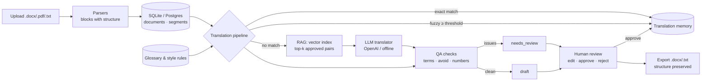

# Glossify AI: AI-Powered Translation Studio (RAG-based)

Glossify translates documents (.docx, .pdf, .txt, .md) with an LLM, while keeping
them consistent with the organisation's **translation memory**, **glossary** and **style rules**.
Every draft goes through automatic quality checks and a **human review** step. Approved
translations are written back into the memory, so the system improves with use.

> Status: the workflow, retrieval, QA, review and export are implemented and tested (33 tests).
> Translation quality depends on the LLM you connect. Without an API key, the app runs in
> *offline mode*, which copies the source text. That lets you test the workflow, but it
> does not produce translations.

## What it does

1. **Ingest.** Parse the file into ordered blocks (headings, paragraphs, list items, table cells) and keep their structure.
2. **Translate.** For each block, reuse an exact or fuzzy translation-memory match if one exists. Otherwise, retrieve similar approved pairs and call the LLM with the glossary terms it must use.
3. **Check.** Run QA on every draft: glossary terms, style rules (words to avoid) and numbers that must be carried over.
4. **Review.** A reviewer edits, approves or rejects each block. Approval teaches the memory.
5. **Export.** Download the translated file with the original headings, lists and tables (blocked until everything is approved, unless forced).

## Architecture



### Modules

| Module | Responsibility |
|---|---|
| `app/ingestion/parsers.py` | File → `Block` list. DOCX keeps headings (style), lists and table cells in document order. PDF uses text extraction and a heading heuristic. |
| `app/memory/translation_memory.py` | Exact lookup (normalised SHA-256 hash), fuzzy lookup (`difflib` similarity), `learn()` on approval. |
| `app/glossary/glossary.py` | Whole-word term matching, rule CRUD, and `check_translation()` (term, avoid and number checks). |
| `app/rag/vector_store.py` | `index()` / `query()` interface. `TfidfVectorStore` (local, char n-grams) and `PineconeVectorStore` (adapter). |
| `app/rag/translators.py` | `Translator` interface, prompt builder, `OpenAITranslator`, `OfflineTranslator`. |
| `app/pipeline/translate.py` | Orchestrates the per-block decision: TM → RAG → LLM → QA → status. |
| `app/pipeline/review.py` | Review state machine: edit (re-runs QA), approve (learns), reject (with comment). |
| `app/export/exporter.py` | Rebuilds headings, lists and tables in `.docx` / `.txt`. |
| `app/main.py` | FastAPI routes only. Each route calls one service. |
| `app/models.py`, `app/db.py` | SQLAlchemy 2.x models and engine setup. |
| `static/` | Review UI (plain JavaScript, no build step). All text is inserted with `textContent`. |

### Data model

```
Document 1 ──< Segment        (position, block_type, heading_level, table/row/col, page,
                               source_text, target_text, status, method, score, qa_issues JSON)
TMEntry                        (source_lang, target_lang, source_text, source_hash UNIQUE,
                               target_text, origin)
GlossaryTerm                   (source_lang, target_lang, kind = term | avoid,
                               source_term, target_term, note)
```

Segment states: `pending → draft | needs_review → in_review → approved | rejected`.

## Key design decisions

| Decision | Why |
|---|---|
| **Three-tier lookup: exact TM → fuzzy TM → LLM** | Reusing an approved translation is cheaper, faster and more consistent than generating a new one. Fuzzy matches are only *suggestions*: they are still reviewed. |
| **Glossary matching is deterministic (regex), not semantic** | Terminology must be exact. A vector search might map "invoice" to "receipt", which is a legal and business error. |
| **Vectors are used only for examples** | Retrieval gives the LLM similar approved sentences as style guidance. The LLM still has to use the glossary terms. |
| **QA is a gate, not a silent fix** | Every problem is listed next to the block. The reviewer decides, and nothing is changed without them knowing. |
| **Approved blocks are never overwritten** | Re-running translation must not undo human work. |
| **Only human-approved pairs enter the memory** | Model output is not trusted until a reviewer has approved it, so errors are not reinforced. Copied source text (offline mode) is not learned either. |
| **Export blocked until everything is approved** | Stops unreviewed machine output from being delivered by accident. `force=true` is available and is an explicit choice. |
| **Providers behind interfaces** (`Translator`, `VectorStore`) | Tests use a deterministic fake translator. OpenAI and Pinecone are swapped in by configuration. |
| **Structure stored per block** | Export can rebuild the original layout, which is the "structure preservation" requirement. |

## API

| Method | Path | Purpose |
|---|---|---|
| POST | `/api/documents` | Upload (multipart: `file`, `source_lang`, `target_lang`) |
| GET | `/api/documents` | List documents |
| GET | `/api/documents/{id}` | Document with all blocks |
| POST | `/api/documents/{id}/translate` | Run the pipeline. Returns counts by method and flagged blocks. |
| GET | `/api/documents/{id}/export?format=docx\|txt&force=` | Download (409 until approved, unless forced) |
| PATCH | `/api/segments/{id}` | Edit a translation. QA re-runs. Status becomes `in_review`. |
| POST | `/api/segments/{id}/approve` | Approve and learn into the translation memory |
| POST | `/api/segments/{id}/reject` | Reject with a comment |
| POST / GET / DELETE | `/api/glossary` | Manage term and style rules |
| GET | `/api/tm/search?q=&source_lang=&target_lang=` | Search past approved translations |
| GET | `/api/health` | Liveness check |

Interactive docs: `http://127.0.0.1:8000/docs`.

## Running it

Requires Python 3.10+.

```bash
python -m venv .venv
.venv\Scripts\activate                 # Windows (macOS/Linux: source .venv/bin/activate)
pip install -r requirements-dev.txt
uvicorn app.main:create_app --factory --reload
```

Open `http://127.0.0.1:8000`.

To enable real translation, set these in `.env` or your shell (see `.env.example`):

```bash
OPENAI_API_KEY=sk-...
OPENAI_MODEL=gpt-4o-mini
```

Optional Pinecone index (needs `OPENAI_API_KEY` for embeddings):

```bash
PINECONE_API_KEY=...
PINECONE_INDEX=glossify
```

Run the tests:

```bash
pytest
```

## Configuration

| Variable | Default | Meaning |
|---|---|---|
| `DATABASE_URL` | `sqlite:///./glossify.db` | Any SQLAlchemy URL (e.g. PostgreSQL) |
| `OPENAI_API_KEY` | empty | Enables the OpenAI translator. Empty = offline mode. |
| `OPENAI_MODEL` | `gpt-4o-mini` | Chat model |
| `PINECONE_API_KEY` / `PINECONE_INDEX` | empty | Enables the Pinecone vector store |
| `FUZZY_THRESHOLD` | `0.75` | Minimum similarity for a fuzzy TM suggestion |
| `RETRIEVAL_K` | `3` | Number of similar approved pairs shown to the LLM |
| `MAX_UPLOAD_MB` | `10` | Upload size limit |

## Testing

| File | Covers |
|---|---|
| `tests/test_parsers.py` | Real `.docx` and `.pdf` files are generated in the test; text and markdown structure |
| `tests/test_translation_memory.py` | Exact and fuzzy matching, language-pair isolation, learning, search ordering |
| `tests/test_glossary_qa.py` | Term and avoid rules, number checks, whole-word matching, rule de-duplication |
| `tests/test_pipeline.py` | TM → RAG → LLM routing, glossary hints to the LLM, retrieved examples, approved blocks are protected, review loop, copied source not learned |
| `tests/test_api.py` | End-to-end HTTP flow: upload → translate → approve → export (txt and docx), 409 gate, glossary CRUD, error codes |

## Limitations (be upfront about these)

* **Offline mode is not a translator.** It copies the text so the workflow can run without an API key.
* **Synchronous processing.** Translation runs inside the request. Long documents need a background queue (Celery / RQ / Arq).
* **No authentication or per-user ownership.** Production use needs login and roles (translator / reviewer / admin).
* **Frontend stack.** The original plan named React and MongoDB. This version uses plain JavaScript and SQLAlchemy so it runs with no Node build step. The repository layer (`app/pipeline`, `app/memory`) is where a MongoDB implementation would go.
* **Pinecone adapter is not exercised by the tests**, because they need API keys. The code follows the Pinecone v3 client, but it should be verified against a real index.
* **Fuzzy TM is a linear scan.** That is fine for thousands of entries. Beyond that, the TM should also live in the vector index.
* **PDF structure is heuristic.** PDFs have no real heading or table markup, so paragraphs come from blank lines and headings from a short Title Case rule.
* **DOCX merged cells** repeat their text in each covered position. Output tables may show the text in those positions.
* **Sentence-level segmentation** is not done. Each paragraph is one block, which can be long for the LLM and for the reviewer.

## Possible next steps

* Background job queue with per-block progress.
* Sentence-level segmentation (spaCy or a rule-based splitter) and alignment for the TM.
* Role-based access, audit log of every change, and comments on blocks.
* Evaluation harness: BLEU / chrF against a held-out set of approved translations, and reviewer edit distance as a quality signal.
* Docker image (`Dockerfile` is included; it has not been built in this environment).

## Project layout

```
app/                  application package (see Modules above)
static/               review UI
tests/                pytest suite
requirements.txt      runtime dependencies
requirements-dev.txt  adds pytest, httpx, fpdf2 (for PDF tests)
Dockerfile            container image (untested)
.env.example          configuration template
```
